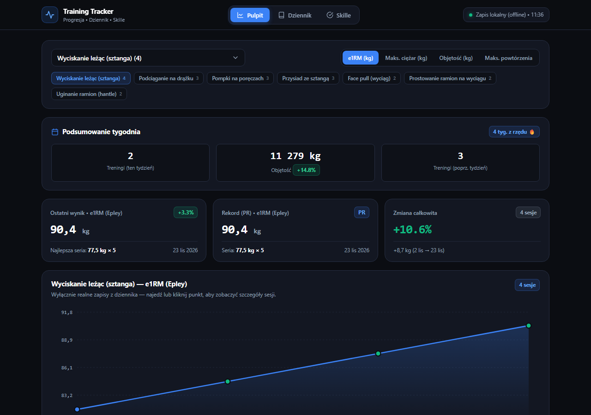
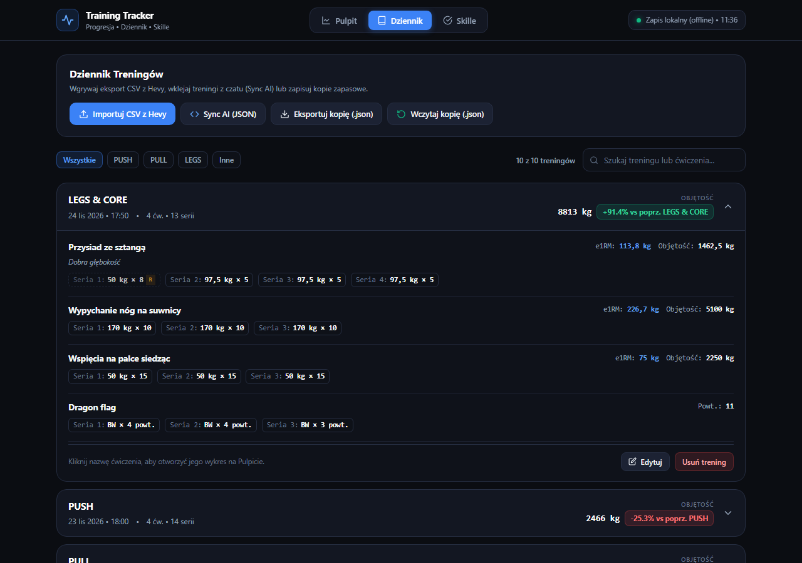
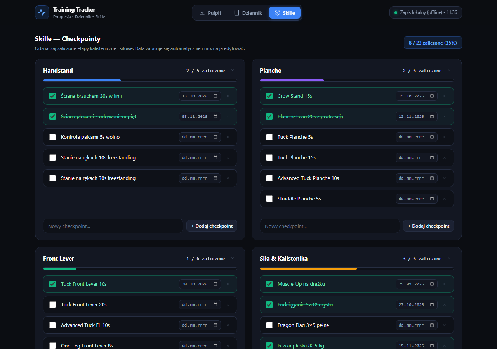

# Training Tracker

A lightweight, offline-first web app for logging strength and calisthenics workouts, tracking progression over time, and importing workout history from Hevy. Built with plain HTML, CSS, and native ES modules with zero runtime dependencies.

**Live demo:** [https://mpecek2077.github.io/training-tracker/](https://mpecek2077.github.io/training-tracker/) *(the UI is currently in Polish)*

## Screenshots

### Progression dashboard


### Workout journal


### Skill checkpoints


## Features

- **Progression tracking** — per-exercise view with Epley e1RM, max weight, session volume, max reps, personal records, and session-by-session history.
- **Weekly summary** — current week vs. previous week workout count, volume delta, and active weekly streak.
- **Hevy CSV import** — merge new workouts (with deduplication) or replace the full history from standard Hevy exports.
- **JSON paste (Sync AI)** — paste one or more workouts as JSON directly into the journal.
- **Workout editor & undo** — edit titles, dates, times, notes, weights, reps, and warmup sets (`R`), with 5-second undo toasts when deleting workouts, checkpoints, or skill categories.
- **Calisthenics skill checkpoints** — track multi-step skills (Handstand, Planche, Front Lever, Strength) with completion dates and custom categories.
- **Backup & PWA support** — full `.json` export/import plus installable offline support via Web App Manifest and Service Worker.

## Implementation notes

- **No bundler or framework:** split into small native ES modules (`analytics.js`, `hevyParser.js`, `demoData.js`, `storage.js`, `chart.js`, `app.js`) so the app runs directly on any static host like GitHub Pages.
- **Custom SVG chart:** renders interactive tooltips on desktop hover and mobile touch, dynamically skips overlapping X-axis date labels, and formats bodyweight movements separately from weighted lifts.
- **Resilient CSV parser:** handles comma and semicolon delimiters, quoted multiline fields, UTF-8 BOM, pound-to-kilogram conversion, warmup set filtering, and both English and Polish Hevy date formats.
- **Local persistence:** stores state in `localStorage` with `QuotaExceededError` handling and `.json` snapshot export/import for moving data between devices.
- **Network-first Service Worker:** caches app assets for offline gym use while picking up fresh updates whenever a connection is available.

## Running locally & tests

Because the app uses native ES modules (`<script type="module">`), serve the directory over HTTP rather than opening `index.html` directly via `file://`:

```bash
npx serve .
# or
python -m http.server 8000
```

Then open `http://localhost:8000` (or the port printed by `serve`).

Unit tests use Node's built-in test runner (Node 20+):

```bash
npm test
```

## Project layout

```text
.
├── .github/workflows/ci.yml
├── css/styles.css
├── docs/screenshots/
├── js/
│   ├── analytics.js
│   ├── app.js
│   ├── chart.js
│   ├── demoData.js
│   ├── hevyParser.js
│   └── storage.js
├── tests/
│   ├── analytics.test.js
│   └── hevyParser.test.js
├── icon-192.png
├── icon-512.png
├── icon.svg
├── index.html
├── manifest.json
├── package.json
└── sw.js
```

## License

[MIT](LICENSE)
